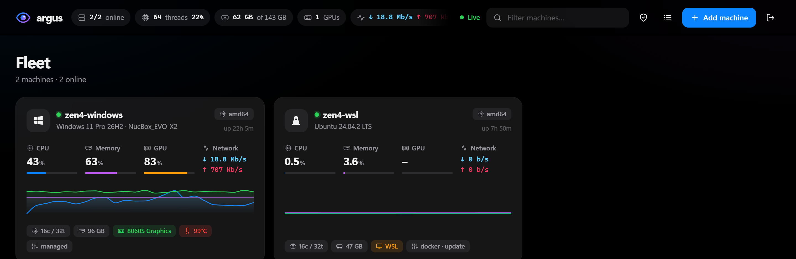
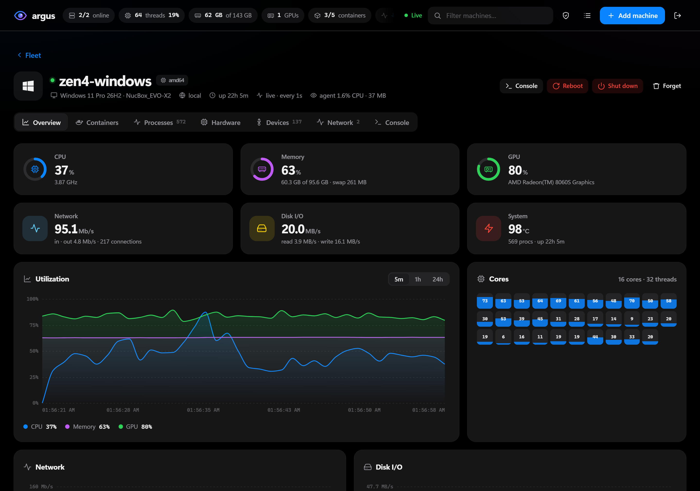
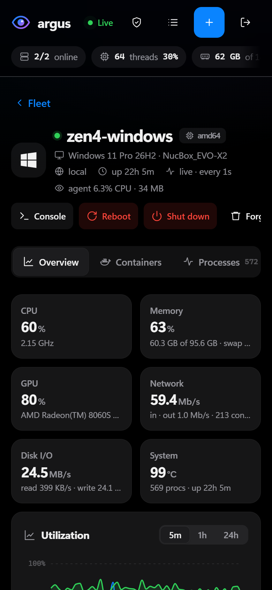

# Argus

**The hundred-eyed watchman for your machines.** Argus monitors and manages a fleet of Apple Silicon Macs, Windows PCs, Linux boxes (amd64, arm64, riscv64, armv7) and VPSes from one live dashboard.

<p align="center">
  
</p>
<p align="center">
  
  &nbsp;
  
</p>

- **One static binary, zero dependencies.** It's Go stdlib only, with no cgo, no modules and no runtime. The ~6 MB executable is the hub, the agent and the embedded dashboard.
- **Nearly free to run.** Agents adapt their cadence to whether anyone is looking:

  | | CPU (one core) | RAM |
  |---|---|---|
  | Linux agent, nobody watching (10 s) | **0.02%** | 11 MB |
  | Linux agent, dashboard open (2 s) | 0.23% | 11 MB |
  | Windows hub + its own agent, idle | 0.15% | 35 MB |

- **Real time, not refresh buttons.** Data streams to the browser over Server-Sent Events. The machine you're viewing reports every second. Commands reach agents instantly over a long-poll channel, and hardware inventory refreshes itself when it changes.
- **Deep inventory.**
  - CPU model, cores (P/E) and ISA flags.
  - Every GPU with driver version, VRAM and API (CUDA, Metal, DirectX, ROCm).
  - Every PCI, USB and Thunderbolt device with its bound driver.
  - Kernel modules, kexts and Windows drivers.
  - NICs, disks, firmware and BIOS, plus virtualization detection.
- **Live metrics.**
  - Per-core CPU and clocks.
  - Memory: Activity Monitor-style on macOS, PSI on Linux.
  - Swap.
  - GPU utilization, VRAM, temperature, power and clock.
  - Per-interface network throughput.
  - Disk I/O and filesystems.
  - Temperatures and fans.
  - CPU/SoC power: RAPL on Linux, `powermetrics` on macOS.
  - Battery, TCP connection states and top processes.
- **Containers.** Docker and Podman via their API sockets (Unix socket or Windows named pipe):
  - Every container with compose project, health, ports, and live CPU, memory and network.
  - Start, stop, restart, logs and inspect.
- **Management** (opt-in per agent, granted per capability): a remote shell/PowerShell console, kill process, container actions, reboot, shut down and **one-click agent updates** across the fleet.
- **Secure by default.** See [Security](#security).

## Quick start

### 1. Run the hub (anywhere: a VPS, a Mac mini, a NAS, Docker)

```bash
./build.sh                                  # or .\build.ps1 → dist/argus-<os>-<arch>
sudo ./dist/argus-linux-amd64 install hub   # systemd/launchd/Task Scheduler service
```

It prints the dashboard URL, your **admin token** (for the dashboard) and the **enroll token** (for agents). Run `argus token` any time to see them again.

**Docker Compose:**

```bash
ARGUS_URL=https://your-hub:7070 docker compose up -d --build
docker compose logs argus | grep -E "admin token|enroll"
```

The image includes agent binaries for every platform, so install one-liners work straight from the hub.

### 2. Add machines

Open the dashboard and click **Add machine**. It shows ready-to-paste commands with your hub's certificate pin baked in:

```bash
# macOS · Linux · VPS
curl -fsSLk --pinnedpubkey 'sha256//<pin>' https://HUB:7070/install.sh | sudo sh -s -- --token <enroll> --manage
```
```bat
:: Windows (any admin terminal)
powershell -NoProfile -ExecutionPolicy Bypass -EncodedCommand <…>
```

`--manage` grants every capability. For finer control, use `--allow` with any of `exec`, `docker`, `kill`, `power` and `update`. For example, `--allow docker,update` gives container control and self-update but no shell. Leave both out for a read-only agent; on Linux, agents without `exec`, `power` or `update` also run in a hardened systemd sandbox.

The installer waits until the agent has enrolled and tells you it's live. Afterwards:

```bash
argus status                 # service state, hub reachability, enrollment, recent log
sudo argus uninstall         # remove the service (add --purge to delete keys and data too)
```

### 3. Keep agents current

When the hub is newer than an agent, the dashboard shows **Update** on that machine and **Update N agents** on the fleet page. The agent downloads its binary from the hub over its pinned connection, checks the SHA-256 the hub sends with it, swaps the binary in place and restarts. This requires the `update` capability.

## Where to put the hub

Agents always **dial out** to the hub. They need no open ports, and NAT is fine. The hub just has to be reachable by every agent:

- **Hub on a VPS (simplest for mixed home + cloud fleets):** home machines and other VPSes all connect out to it. Pass `--url https://<vps-ip>:7070` (or a DNS name) so install commands use the public address.
- **Hub at home:** fine for LAN-only fleets. Add VPSes over Tailscale/WireGuard, or forward the port.
- **Behind a reverse proxy (Caddy/nginx) with a real certificate:** run `argus hub --tls off --trust-proxy --url https://argus.example.com`.

## Security

| Layer | What Argus does |
|---|---|
| Transport | TLS by default with an auto-generated ECDSA P-256 certificate. Installers (`curl --pinnedpubkey`, PowerShell cert hash check) and agents **pin its public key**, so no CA is needed and a man-in-the-middle can't impersonate the hub. Bring your own cert with `--tls-cert/--tls-key`. |
| Dashboard | A separate **admin token** that never appears in install commands. Sessions are random server-side IDs (stored hashed) in an `HttpOnly`, `SameSite=Strict`, `Secure` cookie. State-changing calls require a custom header plus a same-origin check (CSRF). Strict CSP, `X-Frame-Options: DENY`, HSTS. |
| Agents | The **enroll token** only lets a new machine register. Each machine then gets its own random key, stored `0600` on the agent and as a SHA-256 hash on the hub. "Forget" revokes it, and rotating the enroll token invalidates old install commands without touching enrolled machines. |
| Two-factor | Optional TOTP for dashboard sign-in (`argus totp enable`) using any authenticator app. Codes are replay-protected, and no restart is needed. |
| Network | `--admin-cidr 192.168.0.0/16,100.64.0.0/10` hides the dashboard from everyone else, for example to keep it on your LAN or Tailscale. Enrollment and agent traffic stay reachable from anywhere. |
| Abuse | Failed logins, enrollments and agent auth are rate-limited per IP. Request bodies and headers are size-capped, and gzip uploads are size-capped after decompression. |
| Management | **Capability-based and enforced by the agent:** a compromised or misused hub can't make an agent run anything outside the capabilities granted at install. Self-updates are integrity-checked. Every command, login, enrollment and session revocation goes to `<data>/audit.log`, which is viewable in the dashboard (shield icon) with a "sign out everywhere" button. |
| Footprint | Hub secrets live in a root/SYSTEM-only data directory. Read-only Linux agents run with `ProtectSystem=strict`, `NoNewPrivileges` and friends. |

## How it works

```
agent ──POST /api/agent/report (JSON, keep-alive)──────────▶ hub ──SSE──▶ dashboard
      ◀── GET /api/agent/poll (held open: commands + cadence) ┘
```

- **Cadence is driven by the hub:** 10 s when no dashboard is open, 2 s when one is, and 1 s for the machine being viewed. Agents switch the moment someone opens or closes the dashboard.
- **Expensive probes scale with attention:** the process table, TCP states and per-container stats run at full rate only for the machine someone has open, and back off 10× otherwise.
- **Lean streams:** dashboards receive a slim event per machine; the full payload (processes, cores, containers) goes only to whoever is viewing that machine. Agent uploads and dashboard responses are gzip-compressed.
- **Static inventory** is sent once, then re-sent when NICs or addresses change and every 6 h.
- **History:** the hub keeps fixed ring buffers in RAM (high-resolution recent history plus 24 h of 1-minute averages). Inventory and the 24 h history are persisted to `nodes.json`.

### Data sources

| | Linux | macOS | Windows |
|---|---|---|---|
| CPU | `/proc/stat` | `host_processor_info` (Mach) | `GetSystemTimes`, `NtQuerySystemInformation` |
| Memory | `/proc/meminfo`, PSI | `host_statistics64`, `vm.swapusage` | `GlobalMemoryStatusEx`, PDH |
| Network | `/proc/net/dev` | `NET_RT_IFLIST2` route sysctl | `GetIfEntry2` |
| Disk I/O | `/proc/diskstats` | IOKit stats via `ioreg` | PDH `PhysicalDisk` |
| GPU | DRM sysfs (amdgpu, i915, xe, panfrost, v3d…), devfreq, Jetson, streaming `nvidia-smi` | `ioreg` IOAccelerator, `system_profiler`, `powermetrics` | DXGI + PDH `GPU Engine`, streaming `nvidia-smi` |
| Processes | `/proc/[pid]/stat` | `proc_listallpids` / `proc_pidinfo` | one `SystemProcessInformation` call |
| Containers | Engine API + cgroup v1/v2 accounting | Engine API (Docker Desktop, OrbStack, Colima) | Engine API over `\\.\pipe\docker_engine` |
| Devices | `/sys/bus/{pci,usb}`, `pci.ids`, `/proc/modules` | `system_profiler`, `kmutil` | PnP registry + `CM_Locate_DevNode` |

On macOS, libSystem is called without cgo using the same assembly-trampoline technique as `golang.org/x/sys/unix`, so darwin binaries cross-compile from any OS.

## CLI

```
argus hub      [--listen :7070] [--data DIR] [--tls auto|off] [--tls-cert F --tls-key F]
               [--url https://public:7070] [--host NAME,...] [--no-local] [--manage] [--trust-proxy]
               [--interval 2s] [--idle-interval 10s]
               [--admin-cidr CIDR,...]
argus agent    --hub https://HOST:7070 --token ENROLL [--pin sha256/...] [--manage | --allow exec,docker,kill,power,update] [--name NAME]
argus install  hub|agent [flags]
argus uninstall [--purge]
argus status
argus token    [--rotate-admin] [--rotate-enroll]
argus totp     enable|disable
argus snapshot                      # this machine's inventory + metrics as JSON
```

## Development

```bash
go test ./...      # TOTP (RFC 6238 vectors), certificate pinning, CIDR gate, capabilities, gzip-bomb cap, stream slimming
./build.sh         # all 9 targets into dist/
```

## Status

- **Tested end to end** on Windows 11 (amd64, Docker Desktop) and Linux (Ubuntu 24.04 amd64).
- **macOS:** the collector cross-compiles but hasn't yet been verified on Apple Silicon hardware.
- **Other Linux targets:** arm64, riscv64 and armv7 share the tested Linux collector.

## License

MIT © Carsen Klock
